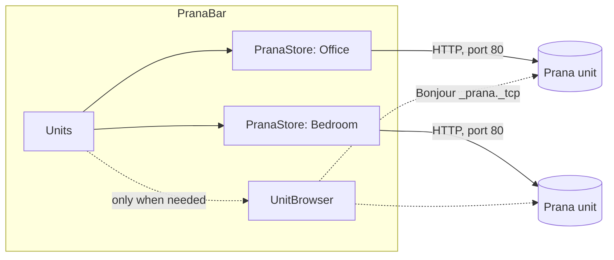

# PranaBar documentation

Everything beyond the [README](README.md): setting up, using, troubleshooting and developing PranaBar, plus notes on the Prana local API.

- [Features](#features)
- [Requirements](#requirements)
- [Setup](#setup)
- [Usage](#usage)
- [How it works](#how-it-works)
- [Troubleshooting](#troubleshooting)
- [Known limitations](#known-limitations)
- [Development](#development)
- [Contributing](#contributing)
- [Prana local API](#prana-local-api)

## Features

| | |
|---|---|
| **Menu bar icon** | The fan speed (1–6, or B for Boost). Dimmed when the unit is off; a warning triangle when it can't be reached. |
| **Glance view** | Click the icon: running state and mode, supply and extract speed, outside and inside temperature, humidity, and air pressure (Low / Normal / High with a 3-hour trend). CO₂ and VOC too, if your model reports them. |
| **Controls** | Fan speed, linked or per fan. Night, Boost, Auto, Auto+, Winter and Heater. Display brightness. |
| **Several units** | One is the default, shown in the menu bar and whenever the popover opens. Click the unit's name in the popover to look at another. |
| **Honest feedback** | The unit says "ok" even to commands it ignores, so PranaBar re-reads it after every change and tells you when one didn't take, for example "The unit didn't link the fans". |

## Requirements

- **macOS 14 (Sonoma) or later.**
- **Swift 5.9 or later**, from Xcode 15+ or just the Command Line Tools. There are no third-party dependencies.
- **A Prana unit on the same network as the Mac.** A unit on a separate network segment (a guest or IoT network, say) can't be found automatically. You can still add it by IP address if your router lets the two networks talk.

There's no prebuilt download. You build the app yourself, which takes about a minute.

## Setup

### Build and install

| Command | What it does |
|---|---|
| `scripts/bundle.sh` | Builds a release `build/PranaBar.app`, signed ad hoc. No Apple developer account needed, and Gatekeeper doesn't block an app you built on your own Mac. |
| `scripts/test.sh` | Runs the tests. Use it instead of `swift test`: with only the Command Line Tools, plain `swift test` silently runs zero tests. |
| `swift run PranaBar` | Runs the app from the terminal while developing. Launch at login only works from the bundled app. |

To work in Xcode, open `Package.swift`.

### First launch

1. **Allow local network access** when macOS asks. If you clicked Don't Allow, turn it on in System Settings → Privacy & Security → Local Network.
2. **Wait a few seconds.** PranaBar searches for units and adds every one it finds. The first one becomes the default.
3. **If your unit doesn't appear,** open Settings → Units → Add a Unit… and type its IP address, for example `192.168.1.40`. Your router's device list shows it.

### Settings

Open Settings from the popover.

| Setting | What it's for |
|---|---|
| **Units** | Add or remove units. "Add Another Unit…" searches the network and also takes an IP address. |
| **Default unit** | The unit shown in the menu bar and each time the popover opens. |
| **Altitude** | Your height above sea level in metres. Pressure is corrected with it, so it matches weather forecasts. Until you set it, the pressure row shows "Set altitude…" instead of a band, because the raw reading always looks low. |
| **Launch at login** | Starts PranaBar when you log in. |

Settings live in the app's defaults, which you can inspect or reset from the terminal:

```sh
defaults read me.martyndavies.PranaBar                # saved units, default unit, altitude
defaults delete me.martyndavies.PranaBar              # start over; first-launch search runs again
```

If you publish your own fork, change the bundle ID in `Support/Info.plist`.

## Usage

- **Change speed:** open Controls in the popover and click a bar on the speed meter. To set supply and extract separately, click the link button to unlink the fans.
- **Pick a mode:** Night, Boost, Auto and Auto+ are one group, so picking one switches the others off. Winter and Heater are separate.
- **Leave Boost:** click Boost again. PranaBar goes back to the speed you had before, and turns Auto or Auto+ back on if one was running.
- **Look at another unit:** click the unit's name at the top of the popover and pick one. The popover goes back to the default unit when it closes.

## How it works



- **Polling:** each unit has its own `PranaStore`. It reads the unit every 3 s while that unit is on screen and every 45 s otherwise.
- **Changes:** a command updates the popover straight away, then PranaBar re-reads the unit to check it took.
- **Finding units:** Bonjour is Apple's way for devices to announce themselves on a network. PranaBar searches only when it has a reason:
  - on first launch, until 30 seconds after the first unit is added (and on every launch until one is found)
  - while the Add a Unit sheet is open
  - while a saved unit isn't answering, in case the router gave it a new address. PranaBar follows it to the new one.

To watch the searches: `log stream --predicate 'category == "discovery"'`.

## Troubleshooting

| Symptom | Try |
|---|---|
| Warning triangle in the menu bar | The unit isn't answering. Check it's powered and on the Wi-Fi. PranaBar searches for it meanwhile and picks up a new address by itself. |
| "Looking for Prana units…" never finishes | Check Local Network access (see [First launch](#first-launch)), or add the unit by IP address. |
| "The unit didn't …" in the popover | The unit ignored the command. Some combinations aren't allowed: for example, fans can't be linked under Auto or Auto+. |
| Pressure shows "Set altitude…" | Set your altitude in Settings. |
| No pressure trend | The trend needs an hour of readings after launch. |

## Known limitations

- **Only tested on one model:** a Prana 150 on firmware 49. Other models and firmware may name sensors differently or treat commands differently. Reports are welcome (see [Contributing](#contributing)).
- **Same network only for discovery.** Other subnets need an IP address.
- **IPv4 only.** The unit doesn't answer over IPv6.
- **No signed release.** You build it yourself.
- **Night can't be switched off directly.** The unit ignores night=false; Night ends when the speed goes above 1.
- **Fans stay linked after Boost.** Boost links them, and the unit offers no way back except a speed change. If Auto or Auto+ was running before, turning it back on unlinks them again.
- **Pressure history is in memory,** so the trend starts over each launch.

## Development

### Layout

| Path | Contents |
|---|---|
| `Sources/PranaKit` | Foundation-only models and the `PranaClient` actor. No UI, so it can be reused in a CLI, App Intents or widgets. |
| `Sources/PranaBar` | The SwiftUI `MenuBarExtra` app. `Units` owns the saved units, one `PranaStore` each, the default unit and the altitude. It also runs `UnitBrowser` (Bonjour). |
| `Support/Info.plist` | Hides the Dock icon (`LSUIElement`), allows local networking, and declares `_prana._tcp` in `NSBonjourServices` (macOS won't search for a service the app hasn't declared). Embedded for `swift run`; copied into the bundle by `scripts/bundle.sh`. |
| `Tests/PranaKitTests` | Tests for the models, encodings, switch rules and saved-unit matching. |

### Scripts

| Script | What it does |
|---|---|
| `scripts/test.sh` | Runs the tests with the framework paths the Command Line Tools need. |
| `scripts/bundle.sh` | Builds and signs `build/PranaBar.app`. |
| `scripts/spike.sh <host>` | Reads `/info` and `/getState` from a unit with curl. `--write` also sends test commands, which **change the unit's settings**. |
| `sudo scripts/fake-units.py Loft Hall` | Pretends to be extra units, so you can try several without owning them. See below. |

### Fake units

`sudo scripts/fake-units.py Loft Bedroom` gives each fake unit its own loopback address (127.0.0.11 onwards), serves the API on port 80 there, and announces it over Bonjour like a real unit. PranaBar finds them with its normal code, and the script prints each command it receives:

```
Loft       FAE4A6BA2053  http://127.0.0.11/getState
Bedroom    FAF69FECD630  http://127.0.0.12/getState
Commands from PranaBar show below. Ctrl-C to stop.
  Loft: /setSpeed {"speed": 30, "fanType": "bounded"}
```

- It copies the real unit's quirks from the [API notes](#prana-local-api): the write encodings, "ok" to ignored commands, the toggle switches, Boost and the link rules.
- It needs root for the addresses and port 80. Ctrl-C removes the addresses.
- Remove the fake units in Settings afterwards, or they'll show as offline.

## Contributing

Issues and pull requests are welcome at [github.com/martyndavies/PranaBar](https://github.com/martyndavies/PranaBar/issues).

**Reporting a bug or a new model.** Please include:

- your Prana model and firmware (`fwVersion` in the output below)
- your macOS version
- what you did, what you expected, and what happened
- the output of `scripts/spike.sh <your unit's IP>`, which only reads

**Sending a change.**

1. Run `scripts/test.sh` and make sure everything passes.
2. Keep `PranaKit` Foundation-only; UI and state belong in `Sources/PranaBar`.
3. Send every device write through `PranaStore.perform`, so the popover updates straight away and the unit is re-read after.
4. Before changing switch logic, read the [API notes](#prana-local-api). The unit's behaviour is surprising in places.
5. Try UI changes against `scripts/fake-units.py` before a real unit.

If you work with a coding agent, `AGENTS.md` gives it the same rules (`CLAUDE.md` points Claude Code there).

### Ideas

- App Intents, so Shortcuts and Siri can boost a unit.
- A global hotkey for Boost.
- An option to show the inside temperature in the menu bar instead of the speed.

## Prana local API

Reference notes from testing a Prana 150 (fw 49). Plain HTTP on port 80, no auth.

```sh
curl http://192.168.1.40/getState
curl -X POST -H 'Content-Type: application/json' -d '{"speed": 30, "fanType": "bounded"}' http://192.168.1.40/setSpeed
```

| Call | Method | Body |
|---|---|---|
| `/info` | GET | |
| `/getState` | GET | |
| `/setSpeed` | POST | `{"speed": 10..60, "fanType": "bounded"\|"supply"\|"extract"}` |
| `/setSpeedIsOn` | POST | `{"value": bool, "fanType": ...}` |
| `/setSwitch` | POST | `{"switchType": "bound"\|"heater"\|"night"\|"boost"\|"auto"\|"auto_plus"\|"winter", "value": bool}` |
| `/setBrightness` | POST | `{"brightness": 0\|1\|2\|4\|8\|16\|32}` |

### Encodings

- **Speed** reads back as a level (1–6) but is written as level × 10.
- **Brightness** reads back as a level (0–6) but is written as the value at that position in `[0, 1, 2, 4, 8, 16, 32]`: writing 4 reads back 3, writing 8 reads back 4.
- **Temperatures** are tenths of °C. The 150 sends `outside_temperature_2` rather than `outside_temperature`.
- **`air_pressure`** looks like mmHg (728–730 here).
- When `bound` is true use `fanType: "bounded"`; otherwise set supply and extract separately.

### Responses

- Commands answer HTTP 200 with `{"result":"ok"}` (served as `text/html`), including commands the unit then ignores.
- A malformed command (unknown switch or fan type, speed out of range, missing fields) gets HTTP 400, and an unknown path 404. An invalid brightness value (5) still got "ok".
- The client treats any `result` other than "ok" as a rejection, though none has been seen.
- "ok" proves nothing, so PranaBar re-reads after each switch command and shows "The unit didn't …" when the value didn't change (`PranaState.applied`). Night is exempt because it follows the speed.
- The unit occasionally drops a request, so `PranaClient.state()` retries once.

### How `setSwitch` treats `value`

Tested 2026-11-19 by sending each switch the value it already had:

| Switch | Behaviour |
|---|---|
| `auto_plus`, `winter` | Toggle, ignoring `value`: `auto_plus=false` while it's off turns it on. |
| `heater`, `auto`, `boost`, `bound` | Honour `value`, except `boost=false`, which is ignored. |
| `night` | `night=false` is ignored. |

So a toggle switch must only be sent when the fresh state differs from the target, or a stale state or a double click flips it the wrong way. `PranaStore` sends commands one at a time and reads the unit just before each one, sending toggles only when needed (`PranaSwitch.isToggle`).

### Modes

- **Not exclusive on the unit.** It reports Night alongside Auto+ or Auto at level 1. PranaBar treats Night, Boost, Auto and Auto+ as one group and switches the others off when you pick one. Winter and Heater are independent of the group.
- **Night follows the fan speed,** not the switch: setting supply to level 2 cleared it, and setting it back to 1 brought it back. So the popover highlights only one speed mode, ranked Boost, Auto+, Auto, Night (`PranaState.activeFanMode`).
- **Any `setSpeed`** ends Auto, Auto+ and Boost; Night returns if the level is 1.
- **Auto on turns Auto+ off,** and so does `auto=false` while Auto+ is on. `night=false` and `boost=false` leave Auto+ on.
- **Boost** runs both fans at level 6 and links them. `boost=false` is ignored (sent twice); a `setSpeed` ends Boost and the fans stay linked. So PranaBar turns Boost off with a speed change: back to the level from before Boost, then Auto or Auto+ if one was on, or level 1 if Boost was started elsewhere. Picking another mode during Boost does the same, then turns that mode on.
- **Winter brings the heater with it:** turning Winter on also turned Heater on, and turning it off turned Heater off.

### Linking and power

- **Auto and Auto+ block linking.** bound=true is answered "ok" but ignored (tried twice under Auto+, read back at 0.2–8 s); with both off it links at once. Turning Auto+ on unlinks the fans. PranaBar greys out the link button under either (`PranaState.linkBlockedBy`).
- **`setSpeedIsOn` with `bounded`** turns the whole unit off even with the fans unlinked, and both speeds read 0 while off. Turning `bounded` back on brings the unit back linked.
- **`setSpeedIsOn` for one fan** unlinks them.
- **Auto and Auto+ block turning the unit off** (tested 2026-11-19 with each mode; under Auto+ watched for 20 s and confirmed on the unit and the phone app):
  - Supply off then extract off: both answered "ok", and nothing changed.
  - `bounded` off: `bounded.is_on` read false, but supply and extract stayed on at level 1, the mode stayed on, and the unit kept running. `bounded` on was then ignored too, until the mode went off.
  - Mode off first (auto_plus toggled, or auto=false), then `bounded` off: the whole unit turned off and stayed off.
  - Turning `bounded` back on brought the unit back linked at level 1 with Night, without the mode.

  So PranaBar's power button reads the unit fresh and, if Auto or Auto+ is on, sends auto=false (which ends both and honours its value) and then `bounded` off. It remembers the mode and turns it back on with the unit. Both steps are checked against the re-read state ("The unit didn't turn off"). Tested end to end on the unit with each mode.

### Pressure

The popover shows pressure as a Low / Normal / High band plus a 3-hour trend, with the hPa figure only in the hover hint.

- **Trend** (`PressureHistory`): averaged over 15 minutes at each end, because the unit only reports whole mmHg. Worked out on raw readings; the altitude correction barely changes it.
- **Altitude correction** (`Pressure.seaLevel`): the standard barometric formula, using the outside temperature. At 0 m the raw reading shows, which is lower than the forecast by about 1 hPa per 8 m of altitude.
- **Band** (`PressureLevel`): Low below 1000 hPa, High above 1025 hPa. Needs an altitude.

### Discovery

- Each unit advertises `_prana._tcp` over Bonjour. The instance name is the `manufactureId` from `/info` (for example `88F155142EEC`), and the host is `<that>.local`.
- The TXT record has `label=` (padded with spaces) and `maxSpeed=`.
- The advertised port, 12345, is closed; the API stays on port 80.
- `UnitBrowser` resolves the host to IPv4, because the unit doesn't answer over IPv6 and a client trying IPv6 first can use up the 4 s timeout.
