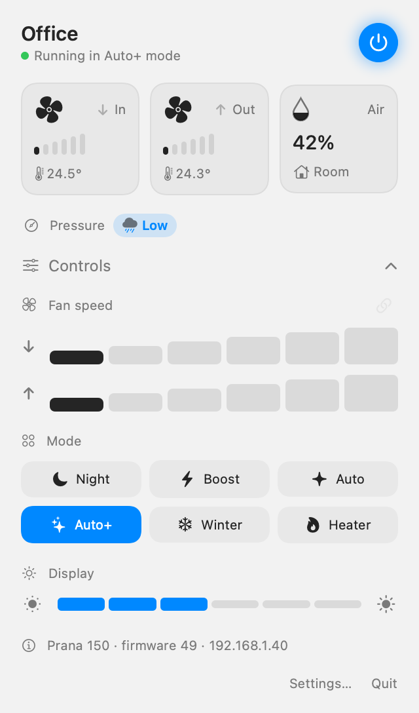

# PranaBar

Control your Prana recuperator from the Mac menu bar. PranaBar talks straight to the unit over your local network, so it needs no cloud account and keeps working when the internet is down.

<p align="center">
  <picture>
    <source media="(prefers-color-scheme: dark)" srcset="docs/popover-dark.png">
    
  </picture>
</p>

- **See it at a glance:** fan speed in the menu bar; temperatures, humidity and pressure one click away.
- **Control it:** fan speed (linked or per fan), Night, Boost, Auto, Auto+, Winter, Heater and display brightness.
- **Several units:** found on the network automatically, with one as the default.
- **Honest:** the unit says "ok" even to commands it ignores, so PranaBar checks and tells you when one didn't take.

## Quickstart

You need macOS 14 or later, Swift 5.9 or later (`xcode-select --install` is enough), and a Prana unit on the same network.

```sh
git clone https://github.com/martyndavies/PranaBar.git
cd PranaBar
scripts/bundle.sh
cp -R build/PranaBar.app /Applications/ && open /Applications/PranaBar.app
```

Click **Allow** when macOS asks about local network access. PranaBar finds your units and puts a fan icon in the menu bar.

Tested on a Prana 150, firmware 49.

## Documentation

[DOCUMENTATION.md](DOCUMENTATION.md) covers [setup](DOCUMENTATION.md#setup), [usage](DOCUMENTATION.md#usage), [troubleshooting](DOCUMENTATION.md#troubleshooting), [known limitations](DOCUMENTATION.md#known-limitations), [development](DOCUMENTATION.md#development) and the [Prana local API](DOCUMENTATION.md#prana-local-api).

## Contributing

Bug reports, reports from other Prana models, and pull requests are welcome. See [Contributing](DOCUMENTATION.md#contributing) for what to include, or [open an issue](https://github.com/martyndavies/PranaBar/issues).

## License

MIT. See [LICENSE](LICENSE).
